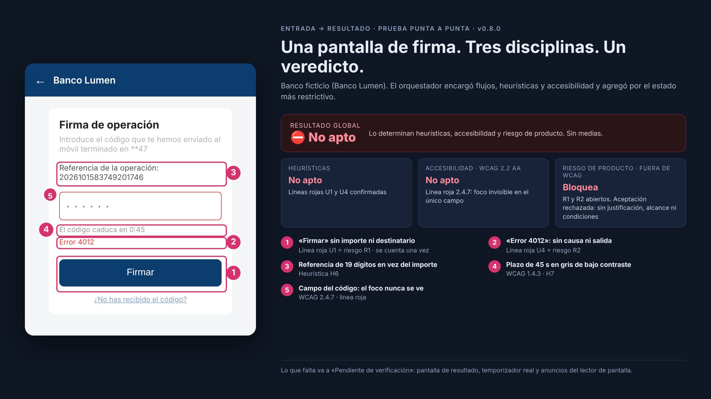
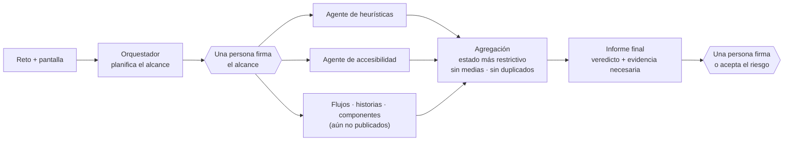

# Agentes de IA de diseño para productos regulados

**Un equipo de agentes de IA que audita productos digitales como lo haría yo: con mi criterio escrito, probado contra hojas de respuestas y honesto sobre lo que no pudo comprobar.**

Creado por **Francia**, Senior Product Designer y Design Systems Lead · [franciadelarosa.com](https://www.franciadelarosa.com) · [Read in English](README.md)



| En resumen | |
|---|---|
| **Qué es** | Un plugin de Claude Code: un orquestador y agentes especialistas en accesibilidad (WCAG 2.2 AA) y evaluación heurística, para productos de banca |
| **Mi papel** | Proyecto individual, octubre de 2026. Definí el criterio, las líneas rojas y las hojas de respuestas, diseñé las pruebas y juzgué cada resultado. Construido con Claude Code; Claude redactó y afinó las skills bajo mi revisión |
| **Resultados** | 13 de 15 problemas sembrados detectados (2 a medias) · 11 de 11 casos de prueba superados (5 de accesibilidad y 6 de heurísticas) · prueba punta a punta aceptada con una incidencia contenida |
| **Estado** | `v0.8.0` validada el 23 oct 2026 · edición pública |

## El problema

En banca, un fallo de usabilidad o de accesibilidad no es estético. Puede hacer que alguien **mueva dinero que no quería mover**, o impedir que una persona que usa lector de pantalla gestione su propia cuenta.

Y, sin embargo, las auditorías de diseño suelen depender de quién las hace: dos revisores, dos veredictos distintos.

**Mi objetivo:** convertir mi criterio de auditoría en agentes que cualquiera del equipo pueda ejecutar y que den resultados que se puedan **defender**: trazables, repetibles y claros sobre lo que queda sin verificar.

## Cómo funciona



| Agente | Qué revisa | Estado |
|---|---|---|
| `accessibility-auditor` | Los 55 criterios A/AA de WCAG 2.2 y lentes de producto regulado (fraude, estados inciertos, autenticación reforzada) | ✅ Validado |
| `ux-heuristics-expert` | Las 10 heurísticas de Nielsen, 14 líneas rojas (usabilidad crítica y patrones engañosos) y Leyes de UX como apoyo | ✅ Validado |
| `design-orchestrator` | Planifica, encarga, agrega y se detiene en cada firma humana | ✅ Validado (integración) |

La demo usa **Banco Lumen, un banco ficticio**. En este repositorio no aparece ningún banco, cliente ni persona real.

<details>
<summary><b>Cómo es un informe</b> (extracto, caso A de accesibilidad)</summary>

> **Estado de aprobación: No apto** · 🔴 4 · Crítico: 1 · 🟠 3 · Mayor: 4 · 🟡 2 · Moderado: 2 · ⚪ 1 · Leve: 2
> Línea roja: **foco invisible**. `input.code` lleva `outline:none` y no tiene estilo de foco alternativo.

| # | WCAG | Elemento | Evidencia | Severidad | Arreglo |
|---|---|---|---|---|---|
| 1 | 2.4.7 Foco visible | `input.code` | `outline:none`, sin `:focus-visible`. Único campo del paso obligatorio de firma. **Línea roja** | 🔴 4 | Anillo de foco ≥ 3:1 con el token de foco [rápido] |
| 3 | 3.3.1 · 3.3.3 Errores | «Error 4012» | No dice qué pasó ni qué hacer; no está asociado al campo | 🟠 3 | Decir qué pasó y qué hacer; `aria-describedby` + `aria-invalid` [rápido] |
| 5 | 1.4.3 Contraste | Enlace «¿No has recibido el código?» | #8aa4c0 sobre #fff = **2,58:1** (calculado). Única vía para recuperar el código | 🟠 3 | Token de enlace ≥ 4,5:1, subrayado [rápido] |

Después, cada informe recoge los **riesgos de producto fuera de WCAG**, lo **no verificable**, la **evidencia necesaria** y las **pruebas con personas usuarias de tecnologías de apoyo**. [Informe completo](evidence/v0.8.0/accesibilidad/caso-A.md)
</details>

## Decisiones clave

- **Criterio escrito, no un prompt largo.** Cada disciplina es una skill versionada con referencias, una plantilla de informe fija y casos de prueba. Así el criterio se puede revisar, probar y cambiar como un producto.
- **Una escala de severidad, reglas de aprobación separadas.** La severidad significa lo mismo en todas partes, pero un solo incumplimiento WCAG A/AA confirmado da *No apto*, y un problema heurístico moderado aislado no.
- **Gana el más restrictivo, sin medias.** Un problema que bloquea en una disciplina nunca se compensa con buenos resultados en otra.
- **Un problema se cuenta una vez.** «Firmar sin ver importe ni destinatario» es una línea roja heurística *y* un riesgo de producto; se informa una vez, conservando el gate más estricto.
- **Firman las personas, no los agentes.** Las exclusiones del alcance, las firmas y las aceptaciones de riesgo exigen una decisión humana explícita. Aceptar un riesgo no es resolverlo.

Todas las reglas están en **[docs/METODO.md](docs/METODO.md)**.

## Diseñado contra la confianza ciega

Un auditor de IA que suena seguro es peligroso en un producto regulado. Por eso los agentes están diseñados para **enseñar sus límites**:

- **Sin evidencia no hay hallazgo.** Lo que falta va a *Evidencia necesaria*. Un supuesto nunca confirma un hallazgo.
- **«Pendiente de verificación» es un resultado real.** Si algo esencial no se puede comprobar, la aprobación queda retenida en vez de adivinarse.
- **Calculado, no estimado.** Los contrastes salen de un script.
- **Trazable.** Fecha, versión de la skill, objeto evaluado y responsable en cada informe.
- **No sustituye a las personas.** Cada informe termina con las pruebas que hay que hacer con personas usuarias de tecnologías de apoyo.

## Cómo lo validé

Probé los agentes como se prueba un producto antes de lanzarlo: hojas de respuestas escritas antes, una sesión nueva por caso, un **aula aislada** que dejaba traza de cada archivo leído y cada acción, y una prueba punta a punta con **10 criterios de aceptación** definidos de antemano.

| Prueba | Resultado |
|---|---|
| Accesibilidad · pantalla con 15 problemas sembrados | No apto · **13 de 15** detectados y 2 a medias · línea roja primero · contraste calculado |
| Accesibilidad · 5 casos | ✅ 5/5 · sin fallos inventados · *Pendiente de verificación* cuando falta evidencia |
| Heurísticas · 6 casos en aula aislada | ✅ 6/6 · solo fuentes permitidas · ninguna acción no pedida |
| Orquestador · punta a punta | ✅ Aceptada, **con una incidencia contenida** (abajo) |
| Exclusión sin confirmar | ✅ Queda *Sin evaluar* → global *Pendiente de verificación* |

Dos exámenes resultaron ambiguos. Corregí los exámenes y los repetí, en lugar de forzar las skills para que pasaran. Todos los informes están en [`evidence/`](evidence/v0.8.0), sin editar.

## Qué falló y qué cambié

- **El agente copiaba de informes anteriores.** → Regla: cada auditoría es independiente.
- **Las sesiones guardaban archivos y hacían commits de git que nadie había pedido.** Lo descubrí en las trazas, no en los informes. → *Evaluar, guardar y hacer commit son tres permisos distintos*, y los exámenes pasaron a un aula aislada.
- **Los huecos del enunciado se trataban como indicios de línea roja.** El examen estaba mal planteado. → Nueva categoría: «información no aportada».
- **Una ejecución confirmó una línea roja apoyándose en un supuesto propio.** La regla ya existía. → Se registró como regresión de aplicación, sin forzar la skill.
- **«Audita esta pantalla» activó al especialista equivocado.** → Los tests de una skill declaran la disciplina; los enunciados neutros se reservan para probar el routing.
- **En la prueba punta a punta, un agente sin validar intentó escribir fuera de su carpeta.** El control de permisos lo bloqueó y no se escribió nada. Se aceptó como incidencia contenida y pasó al backlog, sin presentarlo como un 10/10 limpio.

## Cómo lo usaría en un equipo

- **Antes de la design review o del handoff**, como segunda revisora que no se cansa de comprobar los 55 criterios WCAG.
- **Los hallazgos vuelven como arreglos del design system, no como parches.** Los arreglos apuntan a tokens semánticos (foco, texto secundario, enlace, borde): el problema se resuelve una vez en el sistema y se hereda en todas partes.
- **El criterio se gobierna como un design system:** versionado, con changelog, hojas de respuestas y pruebas de regresión. Si cambia una normativa o una decisión del equipo, cambia la skill y se repiten las pruebas.

## Demo

🎬 **Demo del orquestador (55 s)**: plan → firma humana → rechazo a aceptar un riesgo sin los datos necesarios.

https://github.com/user-attachments/assets/11aee6d2-32cf-4f9b-b94d-342bb9d33268

Las tres pantallas evaluadas (con problemas sembrados, correcta y con seguridad justificada) están en [`demo/`](demo), con sus [capturas](demo/capturas).

## Mapa del repositorio

| Carpeta | Contenido |
|---|---|
| `plugins/design-team/` | Agentes y skills (edición pública) |
| `docs/` | Método: todas las reglas detrás de los agentes |
| `demo/` | Pantallas de Banco Lumen, reto, hojas de respuestas y capturas |
| `evidence/v0.8.0/` | Informes sin editar de las pruebas de validación |
| `notebooks/` | Cuadernos de trabajo: decisiones, iteraciones y aprendizajes |
| `evals/` | Script del examen en aula aislada y lector de trazas |
| `CLAUDE.md` | Reglas del proyecto que siguen los agentes (honestidad, independencia, permisos) |
| `GLOSSARY.md` | Términos en español e inglés |

## Cómo usarlo

Necesita [Claude Code](https://docs.claude.com/en/docs/claude-code/overview).

```bash
claude --plugin-dir ./plugins/design-team
```

Después, por ejemplo: `Revisa la accesibilidad de demo/pantalla-firma.html` o `Haz una evaluación heurística de demo/pantalla-firma.html`.

**Idioma:** las skills están escritas en español de España, el idioma en el que definí y validé el criterio. Los agentes responden en el idioma de quien los usa.

**Edición pública:** deriva de la versión validada 0.8.0. Se han retirado dos archivos de referencia de accesibilidad que citan bancos reales. El orquestador menciona tres especialistas que todavía no se incluyen.

## Límites y siguientes pasos

- No sustituye las pruebas con personas usuarias ni con personas que usan tecnologías de apoyo. Sin una pantalla renderizada no puede verificar teclado ni zoom, y lo dice.
- **Siguiente:** un agente de design system (multimarca, tokens, Web Components y React), validado con el mismo método.
- **Siguiente evidencia:** consistencia entre ejecuciones repetidas del mismo caso y comparación con herramientas automáticas.

## Licencia

© 2026 Francia D La Rosa. **Todos los derechos reservados.** Puedes ver y evaluar este trabajo. Reproducirlo, modificarlo, redistribuirlo o reutilizarlo, también para entrenar modelos de IA, requiere permiso por escrito. Ver [LICENSE](LICENSE).
