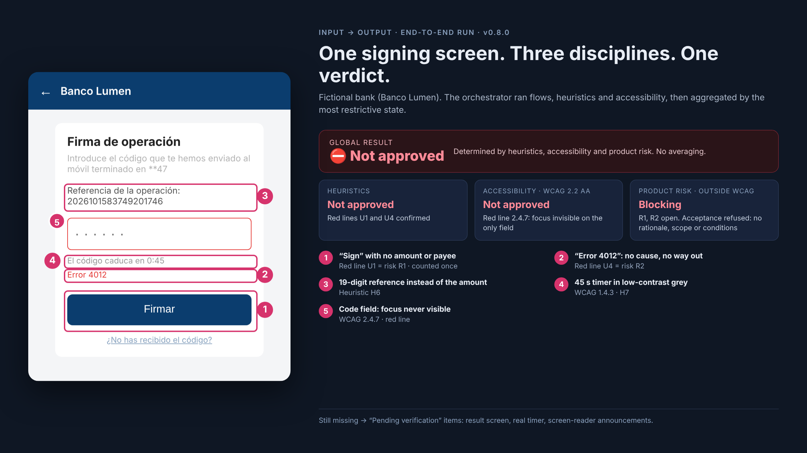
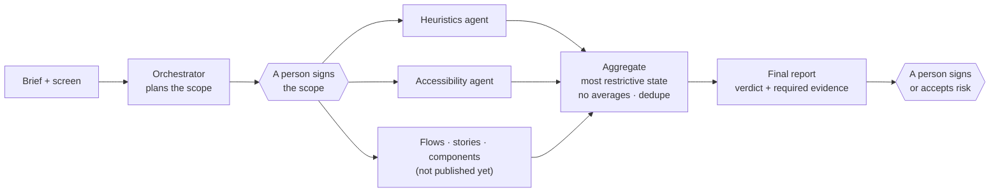

# AI Design Agents for Regulated Products

**A team of AI agents that audits digital products the way I would: with my criteria written down, tested against answer keys, and honest about what they could not verify.**

Built by **Francia**, Senior Product Designer & Design Systems Lead · [franciadelarosa.com](https://www.franciadelarosa.com) · [Leer en español](README.es.md)



| At a glance | |
|---|---|
| **What** | A Claude Code plugin: an orchestrator plus specialist agents for accessibility (WCAG 2.2 AA) and heuristic evaluation, for banking products |
| **My role** | Solo project, October 2026. I defined the criteria, red lines and answer keys, designed the tests and judged every result. Built with Claude Code, with Claude drafting and refining the skills under my review |
| **Results** | 13 of 15 seeded problems detected (2 partially) · 11 of 11 test cases passed (5 accessibility, 6 heuristics) · end-to-end test accepted with one contained incident |
| **Status** | `v0.8.0` validated on 23 Oct 2026 · public edition |

## The problem

In banking, a usability or accessibility failure is not cosmetic. It can make someone **move money they didn't mean to move**, or stop a screen-reader user from managing their own account.

Yet design audits usually depend on who runs them: two reviewers, two different verdicts.

**My goal:** turn my audit criteria into agents that anyone on a team can run, producing results I can **defend**: traceable, repeatable, and explicit about what is still unverified.

## How it works



| Agent | What it checks | Status |
|---|---|---|
| `accessibility-auditor` | All 55 WCAG 2.2 A/AA criteria, plus regulated-product lenses (fraud, uncertain states, strong authentication) | ✅ Validated |
| `ux-heuristics-expert` | Nielsen's 10 heuristics, 14 red lines (critical usability and deceptive patterns), UX laws as support | ✅ Validated |
| `design-orchestrator` | Plans, delegates, aggregates and stops for every human sign-off | ✅ Validated (integration) |

The demo uses **Banco Lumen, a fictional bank**. No real bank, client or person appears in this repository.

<details>
<summary><b>What a report looks like</b> (translated excerpt, accessibility case A)</summary>

> **Approval state: Not approved** · 🔴 4 Critical: 1 · 🟠 3 Major: 4 · 🟡 2 Moderate: 2 · ⚪ 1 Minor: 2
> Red line: **invisible focus**. `input.code` has `outline:none` and no alternative focus style.

| # | WCAG | Element | Evidence | Severity | Fix |
|---|---|---|---|---|---|
| 1 | 2.4.7 Focus visible | `input.code` | `outline:none`, no `:focus-visible`. Only field of the mandatory signing step. **Red line** | 🔴 4 | Add a focus ring ≥ 3:1 using the focus token [quick] |
| 3 | 3.3.1 · 3.3.3 Errors | "Error 4012" | Does not say what happened or what to do; not linked to the field | 🟠 3 | Say what happened and what to do; `aria-describedby` + `aria-invalid` [quick] |
| 5 | 1.4.3 Contrast | "Didn't get the code?" link | #8aa4c0 on #fff = **2.58:1** (calculated). The only way to recover the code | 🟠 3 | Link token ≥ 4.5:1, underlined [quick] |

Every report then lists **product risks outside WCAG**, what was **not verifiable**, the **evidence still needed**, and the **tests to run with assistive-technology users**. [Full report (Spanish)](evidence/v0.8.0/accesibilidad/caso-A.md)
</details>

## Key decisions

- **Written criteria, not a long prompt.** Each discipline is a versioned skill with references, a fixed report template and test cases, so the criteria can be reviewed, tested and changed like a product.
- **One severity scale, separate approval rules.** Severity means the same everywhere, but a single confirmed WCAG A/AA failure means *Not approved*, while an isolated moderate heuristic issue does not.
- **Most restrictive wins, no averaging.** A blocking problem in one discipline is never offset by good results in another.
- **One problem, counted once.** "Signing with no amount or payee" is a heuristic red line *and* a product risk; it is reported once, keeping the strictest gate.
- **People sign, agents don't.** Scope exclusions, sign-offs and risk acceptances need an explicit human decision. Accepting a risk does not resolve it.

The full rules are in **[docs/METHOD.md](docs/METHOD.md)**.

## Designed against over-trust

An AI auditor that sounds confident is dangerous in a regulated product. So the agents are designed to **show their limits**:

- **No evidence, no finding.** Missing information goes to *Required evidence*. An assumption never confirms a finding.
- **"Pending verification" is a real outcome.** If something essential can't be checked, approval is withheld rather than guessed.
- **Calculated, not estimated.** Contrast ratios come from a script.
- **Traceable.** Date, skill version, object evaluated and reviewer in every report.
- **Not a replacement for people.** Every report ends with the tests to run with assistive-technology users.

## How I validated it

I tested the agents like a product before launch: answer keys written first, a fresh session per case, a **sandboxed environment** that traced every file read and every action, and an end-to-end test against **10 acceptance gates** defined in advance.

| Test | Result |
|---|---|
| Accessibility · screen seeded with 15 problems | Not approved · **13 of 15** detected, 2 partially · red line first · contrast calculated |
| Accessibility · 5 cases | ✅ 5/5 · no invented failures · *Pending verification* when evidence is missing |
| Heuristics · 6 cases, sandboxed | ✅ 6/6 · only allowed sources · no unrequested actions |
| Orchestrator · end-to-end | ✅ Accepted, **with one contained incident** (below) |
| Unconfirmed exclusion | ✅ Stays *Not evaluated* → global *Pending verification* |

Two exams turned out to be ambiguous. I corrected the exams and re-ran them, rather than bending the skills to pass. All reports are in [`evidence/`](evidence/v0.8.0), unedited.

## What failed, and what I changed

- **The agent copied from previous reports.** → Rule: every audit is independent.
- **Sessions saved files and made git commits nobody asked for.** I found it in the traces, not in the reports. → *Evaluate, save and commit are three separate permissions*, and exams moved to a sandboxed environment.
- **Gaps in the brief were treated as red-line evidence.** The exam was badly designed. → New category: "information not provided".
- **One run confirmed a red line based on its own assumption.** The rule already existed. → Recorded as an application regression, not "fixed" by forcing the skill.
- **"Audit this screen" routed to the wrong specialist.** → Skill tests declare the discipline; neutral prompts are reserved for routing tests.
- **In the end-to-end test, an unvalidated agent tried to write outside its folder.** The permission control blocked it and nothing was written. Accepted as a contained incident and moved to the backlog, not presented as a clean 10/10.

## How I'd use it in a team

- **Before design review or handoff**, as a second reviewer that never gets tired of checking the 55 WCAG criteria.
- **Findings come back as design-system fixes, not patches.** Fixes point to semantic tokens (focus, secondary text, link, border), so a problem is solved once in the system and inherited everywhere.
- **The criteria are governed like a design system:** versioned, with a changelog, answer keys and regression tests. When a regulation or a team decision changes, the skill changes and the tests run again.

## Demo

🎬 **[Orchestrator demo](demo/video/orquestador-demo-0.8.0.mp4)**: plan → specialists → aggregated result → refusal to accept a risk without the required data.

The three screens evaluated (seeded with problems, correct, justified security) are in [`demo/`](demo), with [screenshots](demo/capturas).

## Repository map

| Folder | Contents |
|---|---|
| `plugins/design-team/` | Agents and skills (public edition) |
| `docs/` | Method: the full rules behind the agents |
| `demo/` | Banco Lumen screens, challenge, answer keys, video and screenshots |
| `evidence/v0.8.0/` | Unedited reports from the validation runs |
| `notebooks/` | Working notebooks: decisions, iterations and lessons (Spanish) |
| `evals/` | Sandboxed exam script and trace reader |
| `CLAUDE.md` | Project rules the agents follow (honesty, independence, permissions) |
| `GLOSSARY.md` | Spanish ↔ English terms |

## Run it

Requires [Claude Code](https://docs.claude.com/en/docs/claude-code/overview).

```bash
claude --plugin-dir ./plugins/design-team
```

Then, for example: `Revisa la accesibilidad de demo/pantalla-firma.html` or `Haz una evaluación heurística de demo/pantalla-firma.html`.

**Language:** the skills are written in Spanish (Spain), the language in which I defined and validated the criteria. Agents answer in the user's language.

**Public edition:** derived from the validated v0.8.0. Two accessibility reference files that cite real banks were removed. The orchestrator references three specialists that are not included yet.

## Limits and roadmap

- It does not replace testing with users or with assistive-technology users. Without a rendered screen it cannot verify keyboard behaviour or zoom, and it says so.
- **Next:** a design-system agent (multi-brand, tokens, Web Components and React), validated with the same method.
- **Next evidence:** consistency across repeated runs of the same case, and a comparison with automated checkers.

## License

© 2026 Francia. **All rights reserved.** You may view and evaluate this work. Reproduction, modification, redistribution or reuse, including for training AI models, requires written permission. See [LICENSE](LICENSE).
