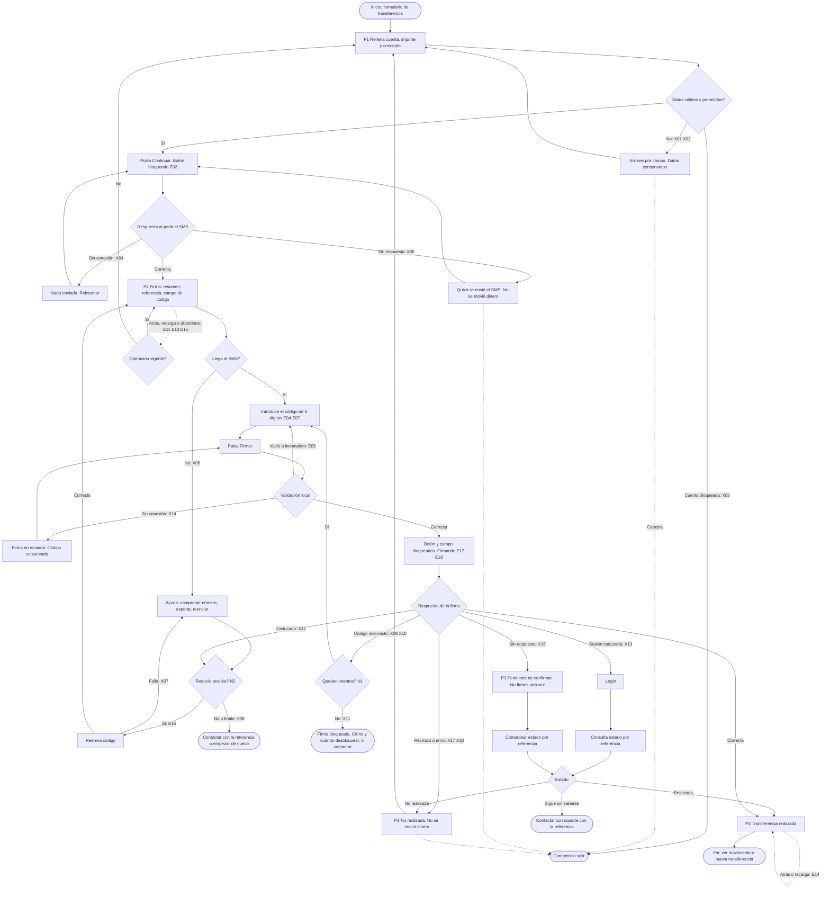

# Mapa de flujo y casos · Firma de transferencia con código SMS (Banco Lumen) · v0.8.0

**Reto:** `demo/caso-firma-operacion.md` · **Plan:** `entregables/firma-0.8.0/00-plan.md` · **Fase:** 2a
**Estado:** borrador para la historia de usuario (2b). Sin respuestas de negocio a las preguntas abiertas.
**Plataforma:** web móvil. **Criterios:** WCAG 2.2 AA y confirmación explícita antes de mover dinero (3.3.4).

## 1. Marco del flujo

- **Quién:** cliente de Banco Lumen, con sesión iniciada, en web móvil. Puede usar lector de pantalla, ampliación, solo teclado o tener mala conexión.
- **Qué quiere:** enviar dinero a otra cuenta y saber con certeza si se ha hecho.
- **Dónde empieza:** formulario de transferencia (cuenta de destino, importe, concepto).
- **Qué es "terminado":** el cliente ve uno de tres estados finales inequívocos: **Realizada**, **No realizada** o **Pendiente de confirmar** (con una vía para resolverlo).

### Supuestos (a confirmar)

- **S1.** Entrada: formulario con sesión activa. Salida: pantalla de resultado con acciones (ver movimiento, nueva transferencia, contactar).
- **S2.** Pantallas del flujo: **P1** Formulario · **P2** Firma · **P3** Resultado. P1 y P3 no tienen prototipo. P2 es `demo/pantalla-firma.html`.
- **S3.** P2 muestra el resumen de lo que se firma (destino, importe, concepto) encima del campo de código. Así el botón Firmar es la confirmación explícita (3.3.4). El flujo actual no lo muestra. A validar con Accesibilidad.
- **S4.** Al pulsar Continuar se crea una operación **pendiente de firma** con su referencia única. Sin esto no se puede recuperar el estado tras un corte. A validar con tecnología (T1, T2).
- **S5.** Pedir el SMS no mueve dinero. Solo la firma correcta lo mueve.

### Lo que se observa en la pantalla actual (entrada para los casos, no es la evaluación)

La evaluación formal va en `04-heuristicas.md` y `05-accesibilidad.md`. Aquí solo se anota lo que obliga a cubrir un caso.

- Se carga ya con el campo en error y el texto "Error 4012", sin explicar qué pasó ni qué hacer (X17).
- El campo no tiene etiqueta visible, solo placeholder. Es `type="text"` sin teclado numérico ni autocompletado de código (E07).
- El teléfono se escribe "**47". Un lector puede leer "asterisco asterisco 47" (E06).
- El tiempo "caduca en 0:45" es texto fijo. No se sabe si se anunciaría ni si se recalcula al volver de otra app (E06, E10).
- Firmar cambia el texto a "Procesando..." pero el botón sigue activo: riesgo de doble envío (E17).
- La flecha del encabezado hace `history.back()` sin avisar (E13).
- "¿No has recibido el código?" es un enlace pequeño que no lleva a ninguna parte (X06).

## 2. Happy path

| # | El usuario… | El sistema… |
|---|---|---|
| 1 | Rellena cuenta de destino, importe y concepto en P1. | Valida al pulsar Continuar, no antes de tiempo. |
| 2 | Pulsa **Continuar**. | Crea la operación pendiente con referencia, envía el SMS de 6 dígitos y abre P2 con foco en el título. |
| 3 | Revisa en P2 el resumen, la referencia y el teléfono terminado en 47. Lee el SMS. | Muestra el tiempo restante de forma pasiva. No anuncia cada segundo. |
| 4 | Introduce o autocompleta el código de 6 dígitos. | Acepta el código sin pedir transcribirlo si el sistema lo ofrece. Conserva lo escrito. |
| 5 | Pulsa **Firmar**. | Bloquea el botón, muestra "Firmando…" y lo anuncia (`role="status"`). |
| 6 | Espera. | Valida el código, ejecuta la transferencia y abre P3 "Transferencia realizada" con importe, destino, referencia y fecha. Foco en el título. |
| 7 | Elige una acción final: ver movimiento o nueva transferencia. | Sale del flujo. |

## 3. Tabla de casos

**Leyenda.** Prioridad: **alta** = puede duplicar o perder dinero, dejar el estado ambiguo, bloquear sin salida o impedir el uso a un grupo. **media** = causa fricción o llamada al soporte. **baja** = molestia menor.
**Depende de:** N = pregunta de negocio, T = pregunta de tecnología (sección 6). Un caso con N o T lleva una **hipótesis** en su respuesta: no es una regla.

### Edge cases (el flujo funciona en condiciones poco habituales)

| # | Tipo | Paso | Situación | Respuesta del sistema | Salida para el usuario | Prioridad | Depende de |
|---|---|---|---|---|---|---|---|
| E01 | edge | 1 | Concepto muy largo, caracteres especiales o importe con coma, punto o muchos decimales. | Valida el formato y avisa en línea con el límite real. Nunca recorta en silencio. | Corrige y continúa. | media | N8 |
| E02 | edge | 2 | Pulsa Continuar dos veces seguidas. | Bloquea el botón en el primer toque. Una sola operación y un solo SMS. | Sigue a P2 una sola vez. | alta | T1 |
| E03 | edge | 1-2 | Primera vez frente a cliente habitual. | Antes de Continuar, una línea: "Te enviaremos un SMS con un código de 6 dígitos". Sin pasos extra para el habitual. | Continúa sin sorpresa. | baja | - |
| E04 | edge | 4 | Pega o autocompleta el código con espacios o guiones ("123 456"). | Permite pegar. Normaliza a solo dígitos. | Firma sin reescribir (3.3.8). | media | - |
| E05 | edge | 4-5 | Código incompleto, con letras, o pulsa Firmar con el campo vacío. | No envía nada. Error en línea: "El código tiene 6 dígitos. Te faltan [n]." Foco al campo. | Completa y firma. | media | - |
| E06 | edge | 2-6 | Usa lector de pantalla. | Al abrir P2, foco en el título. Etiqueta ligada al campo. Teléfono leído como "terminado en 4 7". Tiempo anunciado solo en umbrales. Errores con `role="alert"`. Estados con `role="status"`. Ver sección 7. | Completa el flujo sin ayuda visual. | alta | - |
| E07 | edge | 4 | Solo teclado o teclado móvil. | Orden lógico: campo, Firmar, reenviar, volver. Enter en el campo equivale a Firmar. Teclado numérico (`inputmode="numeric"`, `autocomplete="one-time-code"`). | Firma sin ratón ni cambio de teclado. | media | T7 |
| E08 | edge | 4 | Ampliación al 200-400 %, texto grande o teclado virtual abierto. | Reflow sin scroll horizontal (320 px). Error, tiempo y Firmar visibles con el teclado abierto. Objetivos táctiles de 24 px o más (2.5.8). | Lee y firma sin perder el botón. | media | - |
| E09 | edge | 4 | El código caduca antes de que le dé tiempo a escribirlo (dato del reto). | Tiempo restante visible y estable. Aviso accesible cuando quede poco. Al caducar, ofrece código nuevo en un toque sin perder los datos. **Hipótesis:** si la caducidad es por seguridad, es una excepción a 2.2.1, pero hay que abaratar el reintento. A validar con Accesibilidad. | Pide otro código y sigue. | alta | N2 |
| E10 | edge | 3-4 | Sale a la app de mensajes a leer el SMS y vuelve. | Al volver, recalcula el tiempo con la hora del servidor, no con un contador local congelado. Conserva lo escrito. Si caducó, dice cuándo y ofrece X12. | Retoma donde estaba. | alta | N2, T6 |
| E11 | edge | 4 | Recarga la página en P2 (o se pierde la pestaña). | Recupera la operación pendiente por referencia. No envía otro SMS ni crea otra operación. Muestra el tiempo restante. Si ya se firmó, muestra el resultado. | Sigue o ve el resultado. | alta | T1, T2 |
| E12 | edge | 4-5 | Tiene la misma operación abierta en dos pestañas o dispositivos. | Solo una firma se ejecuta. La otra pestaña muestra el estado actual al intentar firmar. | Ve el resultado real, no un error. | alta | T1, T2 |
| E13 | edge | 3-4 | Vuelta atrás (flecha del encabezado o del navegador) antes de firmar. | Aviso antes de salir: "Si sales, la operación no se firma. Tus datos se conservan." Vuelve a P1 con los datos (3.3.7). **Hipótesis:** el código deja de valer. | Vuelve a editar o permanece en P2. | media | N2, T1 |
| E14 | edge | 6 | Atrás o recarga después del resultado. | No reabre la firma ni permite firmar de nuevo. Muestra el mismo resultado. | Ve el estado final, nunca un formulario firmable. | alta | T1 |
| E15 | edge | 3-4 | Abandona y vuelve minutos u horas más tarde. | Si la operación sigue vigente, vuelve a P2. Si no: "No se firmó. No se ha movido dinero." con los datos precargados. | Empieza de nuevo con un toque. | media | N2 |
| E16 | edge | 3-4 | Pulsa Reenviar varias veces o espera dos SMS. | Un envío por periodo de espera. Botón con cuenta atrás visible. Anuncia "Código enviado". Indica cuál SMS vale ("usa el último"). | Usa el último código. | media | N2, N4 |
| E17 | edge | 5 | Doble envío al Firmar (doble toque, Enter más toque, red lenta). | Bloqueo en el primer toque (`aria-busy`, campo de solo lectura). Cada envío lleva la referencia. Un segundo envío devuelve el mismo resultado y no ejecuta otra transferencia. | Ve un único resultado. | alta | T1 |
| E18 | edge | 5 | Conexión lenta: Firmar tarda. | "Firmando… No cierres ni recargues esta pantalla." Mantiene el bloqueo. Pasado el umbral, pasa a X15, no a un error. | Espera con información o pasa a X15. | alta | T3 |
| E19 | edge | 6 | Lee el resultado con lector de pantalla. La referencia tiene 19 dígitos. | Foco y anuncio del estado. Referencia en bloque aparte, copiable, agrupada para leerla. | Guarda la referencia. | media | - |

### Error cases (algo falla)

| # | Tipo | Paso | Situación | Respuesta del sistema | Salida para el usuario | Prioridad | Depende de |
|---|---|---|---|---|---|---|---|
| X01 | error | 1-2 | Cuenta de destino mal formada, importe vacío o cero, campo obligatorio vacío. | Error por campo y resumen al inicio. Foco al primer error. Dice qué pasa y cómo corregirlo. Datos conservados. | Corrige y continúa. | media | N8 |
| X02 | error | 2 | Saldo insuficiente o límite de operación superado. | "El importe supera [tu saldo disponible / el límite de la operación]. No se ha enviado nada." Sin SMS. | Cambia el importe o cancela. | alta | N8 |
| X03 | error | 2 | Cuenta bloqueada o sin permiso para transferir. | Mensaje sin formulario editable: qué pasa y cómo contactar. | Contacta con el banco o sale. | media | N7 |
| X04 | error | 2 | Sin conexión al pulsar Continuar. | "Sin conexión. No se ha enviado nada ni se ha movido dinero." Datos conservados. | Reintenta al volver la red. | media | - |
| X05 | error | 2 | Tiempo de espera o servicio caído al pedir el SMS (no se sabe si se envió). | "No sabemos si te hemos enviado el código. No se ha movido dinero. Mira tus SMS o pide uno nuevo." | Reintenta, vuelve o contacta. | alta | T3 |
| X06 | error | 3 | SMS no recibido. | El enlace pasa a botón de ayuda: comprobar el número terminado en 47, cobertura, esperar [tiempo]. Ofrece reenviar y, si persiste, contactar con la referencia. **Hipótesis:** puede que el número ya no sea suyo. | Reenvía, contacta o sale. | alta | N2, N7, N9 |
| X07 | error | 3-4 | Falla el reenvío del código. | "No hemos podido enviar el código. Inténtalo otra vez." Si el código anterior sigue vigente, se dice. | Reintenta o contacta. | media | N2 |
| X08 | error | 3-4 | Se alcanza el límite de reenvíos. | "Has pedido el máximo de códigos. [Siguiente paso]." | Contacta o empieza de nuevo. | media | N2, N4 |
| X09 | error | 4-5 | Código incorrecto. | Error en línea junto al campo, `aria-invalid` y `role="alert"`: "El código no es correcto. Revisa el SMS y vuelve a escribirlo." Foco al campo con el contenido seleccionado. Intentos restantes solo si negocio lo decide. No se pierde la referencia. | Corrige y firma de nuevo. | alta | N1 |
| X10 | error | 4-5 | Escribe un código antiguo (tras reenviar) o ya usado. | "Ese código ya no vale. Usa el del último SMS." | Escribe el nuevo. | media | N2, T4 |
| X11 | error | 5 | Intentos agotados: bloqueo de la firma. | "Has superado los intentos. La transferencia no se ha realizado." Sin campo. Dice cómo y cuándo se puede volver a intentar, o contacta. | Contacta, espera o sale. | alta | N1, N6, N7 |
| X12 | error | 5 | Código caducado al pulsar Firmar. | "El código ha caducado. No se ha movido dinero." Botón "Enviar código nuevo" (o "Empezar de nuevo" si no hay reenvío). | Pide otro código. | alta | N2 |
| X13 | error | 3-6 | La sesión caduca a mitad del proceso. | "Tu sesión ha terminado." Tras el login, **consulta el estado por referencia antes** de ofrecer nada: puede haberse firmado. No promete que la operación siga viva. | Inicia sesión y ve el estado real. | alta | N5, T2 |
| X14 | error | 5 | Sin conexión antes de enviar la firma. | "Sin conexión. No hemos enviado la firma ni se ha movido dinero." Conserva el código. No reintenta solo. | Pulsa Firmar al volver la red, si el código sigue vigente. | media | - |
| X15 | error | 5-6 | La firma sale, pero no llega respuesta (corte, timeout, respuesta desconocida). | Estado **Pendiente de confirmar**, nunca "error" ni "éxito": "Hemos recibido tu firma, pero aún no sabemos si la transferencia se ha hecho. No vuelvas a firmar." Comprueba el estado por referencia (consulta automática limitada y botón "Comprobar estado"). Referencia copiable. | Comprueba el estado, mira movimientos o contacta con la referencia. | alta | N3, T2, T3 |
| X16 | error | 5-6 | El usuario intenta firmar de nuevo tras X15. | Si hay estado conocido, lo muestra. Si no, no ofrece Firmar: ofrece Comprobar estado. Si firma, se reutiliza la referencia y no se ejecuta otra transferencia. | Ve el estado real. | alta | N3, T1 |
| X17 | error | 6 | Error genérico del servidor (el actual "Error 4012"). | Traduce el error a causa y acción, y dice si se movió dinero. El código técnico va en segundo plano, para soporte. Si no se puede saber, se trata como X15. | Reintenta, contacta o sale. | alta | T5 |
| X18 | error | 6 | Rechazo definitivo (fondos, antifraude, destino). | P3 **No realizada**: "No se ha movido dinero." Motivo si se puede mostrar. | Corrige y empieza de nuevo, o contacta. | alta | T5 |

### Recuento

| Tipo | Casos | Alta | Media | Baja |
|---|---|---|---|---|
| Happy path | 1 camino (7 pasos) | - | - | - |
| Edge | 19 | 9 | 9 | 1 |
| Error | 18 | 11 | 7 | 0 |
| **Total** | **37 casos + happy path** | **20** | **16** | **1** |

### Casos más críticos para el dinero

1. **X15** y **X16**: firma enviada sin respuesta. Es el origen de las llamadas al soporte. Riesgo de duplicado.
2. **E17**, **E12**, **E14**: doble envío por toque, por pestaña o por vuelta atrás.
3. **X13**: la sesión caduca y el cliente no sabe si la operación se firmó.

## 4. Matriz de estados por pantalla

| Pantalla | Vacío | Carga | Éxito | Error | Sin permisos | Sin conexión |
|---|---|---|---|---|---|---|
| **P1 Formulario** | Campos vacíos con etiqueta visible. Línea sobre el SMS. Continuar activo. Puede: rellenar y pulsar. | Continuar bloqueado con "Enviando código…" (`role="status"`). Datos conservados. Puede: esperar. | Pasa a P2 con foco en el título. | Error por campo y resumen. Foco al primer error. Casos X01, X02, X05. Puede: corregir, reintentar o cancelar. | Cuenta bloqueada o sin permiso: mensaje y contacto, sin formulario editable (X03). Puede: contactar o salir. | "Sin conexión. No se ha enviado nada." Datos conservados. Puede: reintentar al volver la red (X04). |
| **P2 Firma** | Resumen, referencia, teléfono, tiempo y campo de código vacío con etiqueta. Firmar activo, valida al pulsar. Puede: escribir, reenviar o volver. | Dos cargas. **Esperando SMS:** campo activo y "Puede tardar unos segundos". **Firmando:** botón y campo bloqueados, "No cierres ni recargues". Pasado el umbral, X15. | No es final. Reenvío correcto: "Código enviado", campo limpio y tiempo reiniciado. Firma correcta: pasa a P3 Realizada. | Código incorrecto, caducado, antiguo o intentos agotados (X09-X12). Cada uno con mensaje, causa y acción. Puede: corregir, pedir código nuevo, contactar. | Sesión caducada (X13) o firma bloqueada por intentos (X11). Sin campo. Puede: iniciar sesión, contactar o salir. | Aviso fijo "Sin conexión". Conserva el código. Firmar no envía y lo dice (X14). Puede: reintentar al volver la red. |
| **P3 Resultado** | No aplica: siempre llega con un estado. Si no hay estado, se trata como Carga. | "Comprobando el estado de tu transferencia…" (`role="status"`). Sin botón de firmar. Puede: esperar o contactar. | **Realizada.** Importe, destino, fecha y referencia copiable. Puede: ver movimiento o nueva transferencia. | **No realizada** (X18, X17): "No se ha movido dinero" y motivo. **Pendiente de confirmar** (X15): "No vuelvas a firmar". Puede: comprobar estado, contactar con la referencia. | Sesión caducada al consultar: login y vuelta a P3 por referencia (X13). Puede: iniciar sesión. | No se puede comprobar. Muestra el último estado conocido con su hora y "Comprobar estado" al volver la red. Un estado Realizada no cambia. |

### Estados finales de la operación (P3)

Cada estado tiene un único mensaje, venga de la ruta que venga.

| Estado | Cuándo | Mensaje base (borrador) | Salidas |
|---|---|---|---|
| **Realizada** | El sistema confirma la ejecución. | "Transferencia realizada. Hemos enviado [importe] a [destino]." | Ver movimiento. Nueva transferencia. |
| **No realizada** | El sistema confirma que no se ejecutó (X12, X18, X11, E15). | "La transferencia no se ha realizado. No se ha movido dinero. [Motivo.]" | Corregir y reintentar. Contactar. |
| **Pendiente de confirmar** | No hay confirmación en ningún sentido (X15, X13 sin estado). | "Aún no sabemos si se ha hecho. No vuelvas a firmar. Referencia [n]." | Comprobar estado. Ver movimientos. Contactar con la referencia. |

## 5. Diagrama

## 6. Preguntas abiertas

Las respuestas de negocio no están en el reto. No se inventa ninguna regla. Lo que sigue son preguntas o hipótesis.

### Negocio

| ID | Pregunta | Casos que dependen |
|---|---|---|
| N1 | Cuántos intentos de código se permiten antes de bloquear la firma. ¿Se muestran los intentos restantes? | X09, X11 |
| N2 | Cuánto dura el código. Si se puede reenviar y cuántas veces. Qué pasa con la operación pendiente cuando caduca el código. | E09, E10, E13, E15, E16, X06, X07, X08, X10, X12 |
| N3 | Qué pasa con la transferencia si la conexión se corta justo después de firmar: ¿se ejecuta, se cancela o queda en revisión? ¿En cuánto tiempo se sabe? | X15, X16 |
| N4 | Tiempo de espera entre reenvíos y número máximo de reenvíos. | E16, X08 |
| N5 | Duración de la sesión y qué datos de la transferencia se pueden conservar al volver tras el login. | X13 |
| N6 | Cuánto dura el bloqueo y cómo se desbloquea. | X11 |
| N7 | Canal de contacto (teléfono, chat, oficina), horario y qué dato debe dar el cliente. | X03, X06, X11 |
| N8 | Reglas de validación y límites: formato de cuenta, importe máximo, longitud y caracteres del concepto. Cuándo se comprueba el saldo. | E01, X01, X02 |
| N9 | Si el SMS no llega, ¿hay otro canal (llamada, app) o forma de cambiar el número? | X06 |

### Tecnología

| ID | Pregunta | Casos que dependen |
|---|---|---|
| T1 | ¿La operación tiene referencia única creada antes de firmar y la firma es idempotente (repetirla no duplica)? **Hipótesis S4.** Es la condición para evitar duplicados. | E02, E11-E14, E17, X16 |
| T2 | ¿Se puede consultar el estado por referencia? ¿Hay pantalla de movimientos o estado para el cliente? | E11, E12, X13, X15 |
| T3 | Umbral de tiempo de espera de la firma y de la petición del SMS. Qué se hace pasado ese tiempo. | E18, X05, X15 |
| T4 | ¿Un código nuevo invalida el anterior? | X10 |
| T5 | Catálogo de errores: qué significa "4012" y cuáles son definitivos (no se movió dinero) frente a desconocidos. | X17, X18 |
| T6 | ¿La caducidad se calcula con la hora del servidor? | E10 |
| T7 | Soporte de `autocomplete="one-time-code"` y WebOTP en los navegadores objetivo. | E07 |

## 7. Lector de pantalla: qué se anuncia y cómo

Pendiente de verificar en dispositivo con VoiceOver y TalkBack. Con HTML estático no se puede comprobar el anuncio real.

| Evento | Mecanismo propuesto | Qué se oye (borrador) |
|---|---|---|
| Llega a P2 | Foco en el título | "Firma de la operación." |
| Teléfono enmascarado | Texto legible | "Código enviado al móvil terminado en 4 7." |
| Tiempo restante | Texto pasivo. Aviso `role="status"` solo en umbrales | "Te quedan [n] segundos." (umbral por definir con N2) |
| Reenvío correcto | `role="status"` | "Código enviado." |
| Error de código | `role="alert"` y foco al campo | "El código no es correcto. Revisa el SMS y vuelve a escribirlo." |
| Firmando | `role="status"` y `aria-busy` | "Firmando. No cierres esta pantalla." |
| Resultado | Foco en el título de P3 | "Transferencia realizada." / "No realizada." / "Pendiente de confirmar." |
| Sin conexión | `role="status"` o `alert` según gravedad | "Sin conexión. No se ha enviado nada." |

## 8. Validación (paso 7 del procedimiento)

- **Sin callejones:** los 37 casos terminan en reintentar, corregir, contactar o salir. Los cierres duros (X03, X11, X08, "sigue sin saberse") dependen de N7: **sin canal de contacto definido, no hay salida**.
- **Mensajes:** todo mensaje en el flujo del dinero dice qué pasó, si se movió dinero y qué hacer. Los textos entre corchetes dependen de decisiones abiertas.
- **Un estado, un mensaje:** las rutas X11, X12, X18 y E15 convergen en **No realizada**. X13 y X15 convergen en **Pendiente de confirmar** si no hay estado.
- **Sin verificar:** anuncio del lector, caducidad real, reenvío y recuperación por referencia. La pantalla actual es estática (ver `00-plan.md`).
- **Alcance:** este documento no evalúa la pantalla. Eso queda en `04` y `05`.
